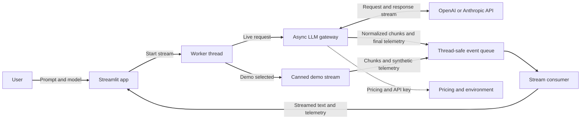

# Multi-provider LLM gateway

An async gateway for streaming responses from OpenAI and Anthropic models, with a Streamlit web client for trying models and viewing generation telemetry.

## Project overview & architecture

The Streamlit client sends the prompt and selected model to a background worker. The worker streams normalized chunks from the gateway into a queue; the client displays the response and updates telemetry as chunks arrive. The gateway routes requests to the matching provider and attaches usage and timing data to the final chunk.



## Features

- Stream responses from supported OpenAI and Anthropic models.
- View time-to-first-token, generation speed, token counts, and estimated cost.
- Configure and use either provider independently.

## Requirements

- Python 3.11 or later
- [uv](https://docs.astral.sh/uv/)
- An API key for the provider you want to use

## Set up

From the repository root, install the project dependencies:

```bash
uv sync
```

Create a local environment file from the example:

```bash
cp .env.example .env
```

Add the API key for the provider you plan to use to `.env`:

```dotenv
OPENAI_API_KEY=your_openai_key
ANTHROPIC_API_KEY=your_anthropic_key
```

Only the key for the provider you select is required. Keep your `.env` file private; do not commit API keys.

## Run locally

Launch the Streamlit client from the repository root:

```bash
uv run streamlit run src/multi_provider_llm_gateway/app.py
```

Choose a provider and model, enter a prompt, and submit to stream a response. The sidebar shows live estimates while generating; final token counts come from the provider. Cost is estimated using the project's configured model pricing, which may not reflect current provider rates.

Set `LLM_GATEWAY_DEMO=1` to add a `Demo` provider that streams a canned response — useful for exercising the UI without API keys.

## Run tests

Run the test suite from the repository root:

```bash
uv run pytest
```

## About

Created for AD331 at North Seattle College, October 2026. Developed with assistance from AI coding agents, with a human guiding the work, reviewing changes, and validating behavior.
