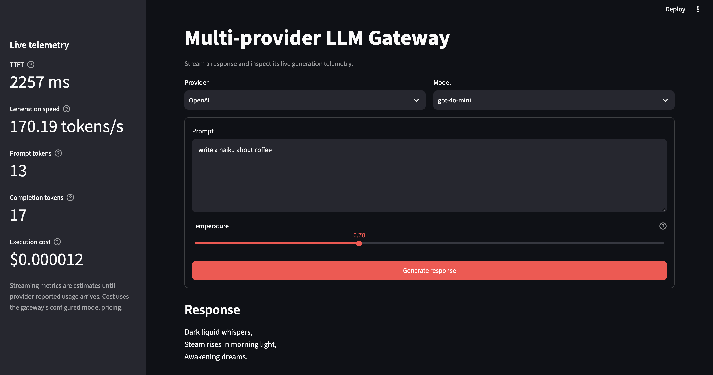
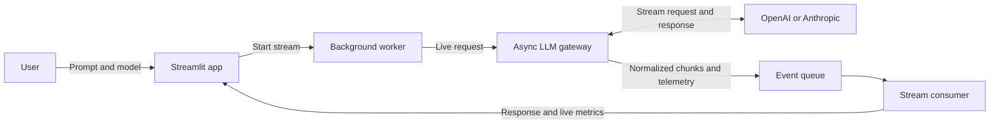
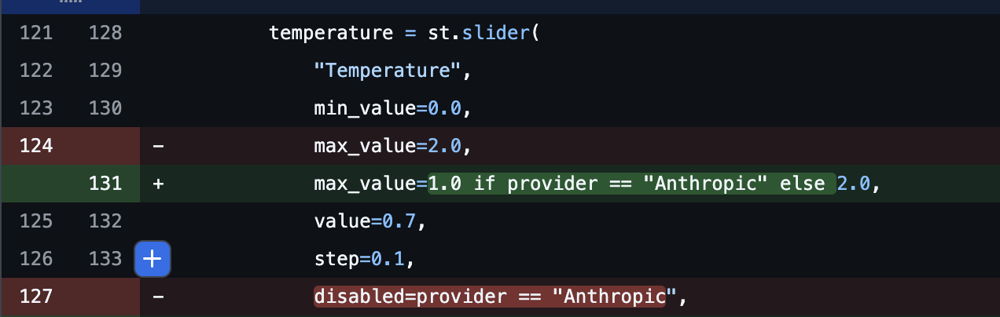

# Multi-provider LLM gateway

An async gateway for streaming responses from OpenAI and Anthropic models, with a Streamlit web client for trying models and viewing generation telemetry.

## App preview


## Project overview & architecture

The Streamlit client sends the prompt and selected model to a background worker. The worker streams normalized chunks from the gateway into a queue; the client displays the response and updates telemetry as chunks arrive. The gateway routes requests to the matching provider and attaches usage and timing data to the final chunk.



## Features

- Stream responses from supported OpenAI and Anthropic models.
- View time-to-first-token, generation speed, token counts, and estimated cost.
- Configure and use either provider independently.

## Pricing

The gateway estimates cost using the following configured rates, in USD per
million tokens:

| Provider | Model | Input | Output | Best use case |
| --- | --- | ---: | ---: | --- |
| OpenAI | `gpt-4o-mini` | $0.15 | $0.60 | Fast, lower-cost everyday tasks |
| OpenAI | `gpt-4o` | $2.50 | $10.00 | General-purpose tasks needing stronger capability |
| Anthropic | `claude-sonnet-5-5` | $2.00 | $10.00 | Balanced coding and reasoning |
| Anthropic | `claude-haiku-5-5` | $0.10 | $0.50 | Fast, lower-cost tasks |
| Anthropic | `claude-opus-5-5` | $4.00 | $20.00 | Complex coding and reasoning |
| Anthropic | `claude-sonnet-4-6` | $3.00 | $15.00 | Balanced coding and reasoning |
| Anthropic | `claude-haiku-4-5` | $1.00 | $5.00 | Fast, lightweight tasks |
| Anthropic | `claude-opus-4-5` | $5.00 | $25.00 | Complex coding and reasoning |

These are static estimates configured in the project, not live provider rates.
Verify current prices with the provider; rates may change.

## Requirements

- Python 3.11 or later
- [uv](https://docs.astral.sh/uv/)
- An API key for the provider you want to use

## Set up

From the repository root, install the project dependencies:

```bash
uv sync
```

Create a local environment file from the example:

```bash
cp .env.example .env
```

Add the API key for the provider you plan to use to `.env`:

```dotenv
OPENAI_API_KEY=your_openai_key
ANTHROPIC_API_KEY=your_anthropic_key
```

Only the key for the provider you select is required. Keep your `.env` file private; do not commit API keys.

## Run locally

Launch the Streamlit client from the repository root:

```bash
uv run streamlit run src/multi_provider_llm_gateway/app.py
```

Choose a provider and model, enter a prompt, and submit to stream a response. The sidebar shows live estimates while generating. Final token counts use provider-reported usage when available; if a stream ends without usage data, the gateway falls back to local estimates and labels their source. Cost is estimated using the project's configured model pricing, which may not reflect current provider rates.

Set `LLM_GATEWAY_DEMO=1` to add a `Demo` provider that streams a canned response — useful for exercising the UI without API keys.

## Run with Docker

Build the image from the repository root:

```bash
docker build -t llm-gateway .
```

Run it with the provider keys from your local `.env` file:

```bash
docker run --rm -p 8501:8501 --env-file .env llm-gateway
```

Open [http://localhost:8501](http://localhost:8501). To use the demo provider
without API keys, run:

```bash
docker run --rm -p 8501:8501 -e LLM_GATEWAY_DEMO=1 llm-gateway
```

The `.env` file is passed to the container at runtime and excluded from the Docker build context, so API keys are not copied into the image.

## Run tests

Run the test suite from the repository root:

```bash
uv run pytest
```

## Audit & verification summary

Review of the initial AI-generated implementation identified several issues that were corrected and covered by tests:

- **Retired Anthropic model IDs:** The initial catalog used model IDs that returned 404 errors. The catalog and pricing table were updated to the model IDs now configured by the project.
- **Anthropic temperature handling:** The initial UI disabled temperature selection for Anthropic, and the gateway did not pass the value through. The final app exposes the provider's configured range and forwards temperature to the API.
- **Missing usage data:** The initial implementation failed when a stream ended without usage information. The final gateway preserves streamed text, estimates token counts locally when possible, and marks estimates with `token_count_source="tiktoken_estimate"`.
- **Provider error details:** The initial broad error handling hid useful status information for errors such as an unknown model. The final gateway maps provider errors to domain errors and includes status and sanitized detail where available.

These examples summarize issues found during development; they are not a claim that the project has undergone a comprehensive security or production-readiness audit.

### Sample diffs

The temperature update


Update Claude sonnet model from 3.5 to 5.5


Update Claude haiku model from 3.5 to 4.5


## About

Created for AD331 at North Seattle College, October 2026. Developed with assistance from AI coding agents, with a human guiding the work, reviewing changes, and validating behavior.
